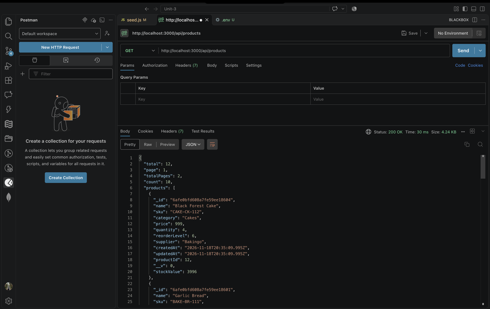
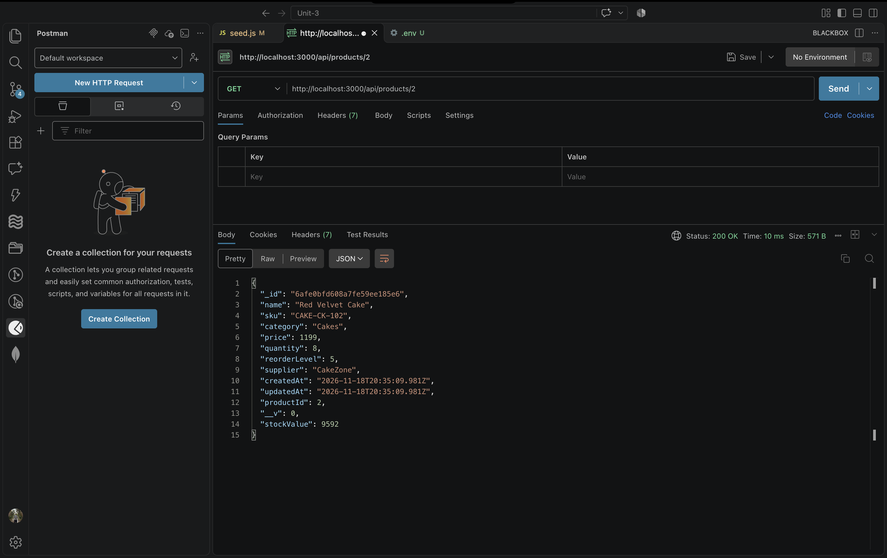
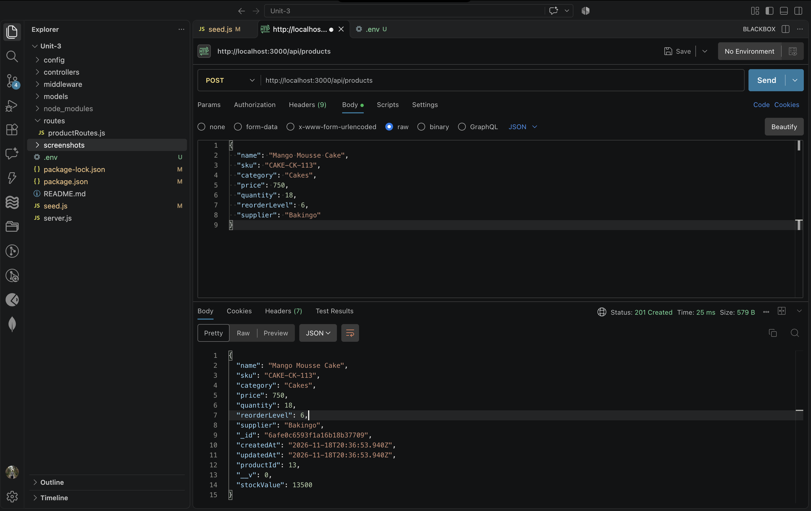
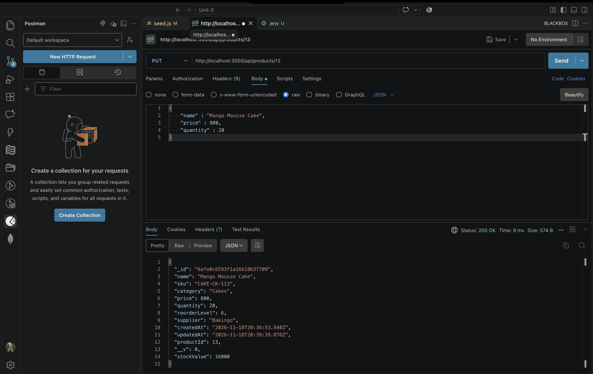
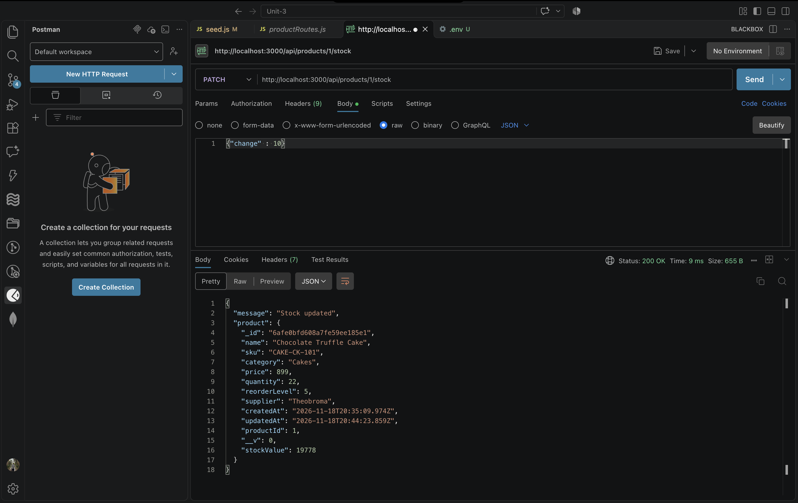
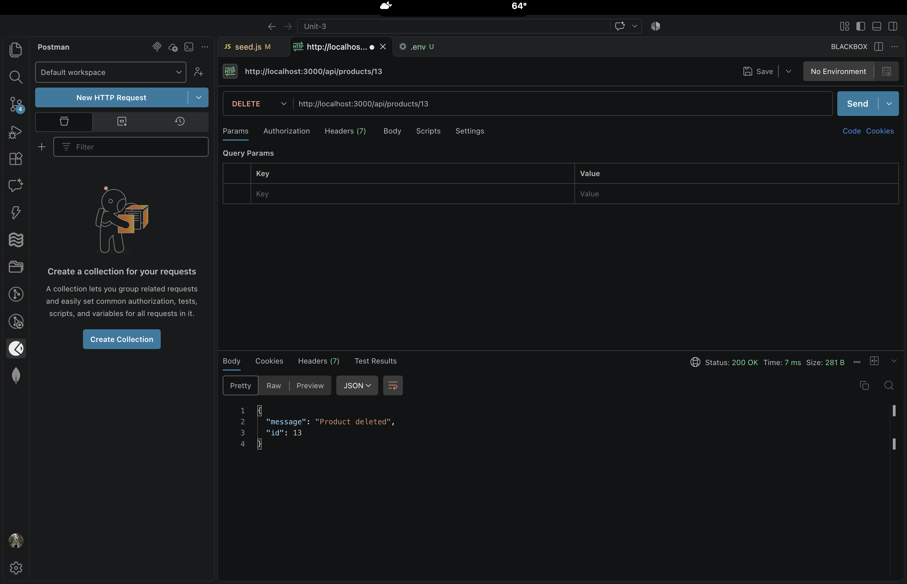
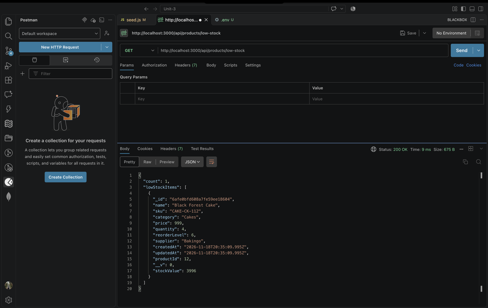

## API Testing Screenshots (Postman)

### 1. GET All Products

### 2. GET Product by ID

### 3. POST - Create Product

### 4. PUT - Update Product

### 5. PATCH - Update Product Stock

### 6. DELETE - Delete Product

### 7. GET - Category Summary

### 8. GET - Low Stock Products

